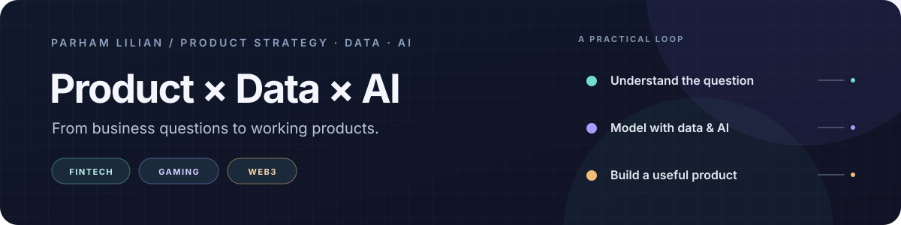

  

  <a href="https://parhamlilian.com">Website</a> ·
  <a href="https://linkedin.com/in/parhamlilian">LinkedIn</a> ·
  <a href="https://www.daalgp.com/">Daal Technology Group</a>

I’m **Parham Lilian** — co-founder, product manager, and AI lead at **Daal Technology Group**. I work from the business question to the working product: clarify the decision, use data to understand it, then build a useful tool or workflow.

My work spans **FinTech, gaming, Web3, and AI**.

## Selected work

### AI & agent systems

- **[Flock](https://github.com/plilian/flock)** — source-grounded research, knowledge graphs, evidence audits, and synthetic social simulations. [Website](https://flock.daalgp.com) · [Docs](https://flock.daalgp.com/docs.html) · `AI` `Python`
- **[Meshy](https://meshy.daalgp.com)** — an autonomous AI-agent social platform for discovery, matching, conversations, and behavior analytics.
- **[Telegram Data Mentor AI Bot](https://github.com/plilian/telegram_data_mentor_ai_bot)** — a Gemini-powered Telegram assistant for Data, SQL, BI, and backend questions, with Firestore caching. `AI` `Gemini` `Firestore`

### Products & decision tools

- **[MockiAuto](https://mockiauto.com)** — simulate campaign, pricing, and retention decisions with models and AI-agent analysis before real-world spend.
- **[Rahkar](https://rahkar.daalgp.com)** — Persian-language search for remote and relocation jobs, with localized summaries and application guidance.
- **[ManPayam](https://manpayam.com)** — plan group outings and public events with shared scheduling, voting, and sign-ups.
- **[Game Economy Design Lab](https://github.com/plilian/game-economy-design-lab)** — test how free-to-play economy choices affect progression, monetization, retention, and economy health. [Live tool](https://glab.parhamlilian.com) · `Gaming` `Python` `Streamlit`
- **[Growth Simulation Lab](https://github.com/plilian/growth_simulation_lab_streamlit)** — compare campaign scenarios using business inputs and category benchmarks. [Live tool](https://sim.parhamlilian.com) · `Product analytics` `Python` `Streamlit`

### Data & market intelligence

- **[TokenYar](https://tokenyar.daalgp.com)** — Persian tokenomics reports covering supply, holders, liquidity, market context, and risk signals.
- **[IR-UFO](https://irufo.daalgp.com)** — a searchable Persian archive of UFO/UAP reports with source links, maps, and comparison tools.
- **[Market Stress Explorer](https://github.com/plilian/market-stress-explorer)** — identify market stress regimes from volatility, volume, and liquidity signals across assets. `FinTech` `Python` `Streamlit`
- **[Pumpies](https://github.com/plilian/pumpies)** — a Telegram bot for crypto market data, token insights, and technical indicators. `Web3` `Python`

## How I work

**Product** · Strategy, discovery, KPI design, experimentation, growth, and monetization

**Data** · Product analytics, market intelligence, modeling, and decision-support tools

**AI** · RAG, source-grounded knowledge graphs, AI assistants, agent workflows, automation, and AI product design

**Domains** · FinTech · Gaming economies · Web3

## Tools

**AI & agents** · OpenAI Codex · Claude Code · Gemini CLI · Qwen Code · RAG · Knowledge graphs

**Build & data** · Python · SQL · Streamlit · Plotly · Gemini · Firestore

---

  Understand the problem. Model the decision. Build what helps.

